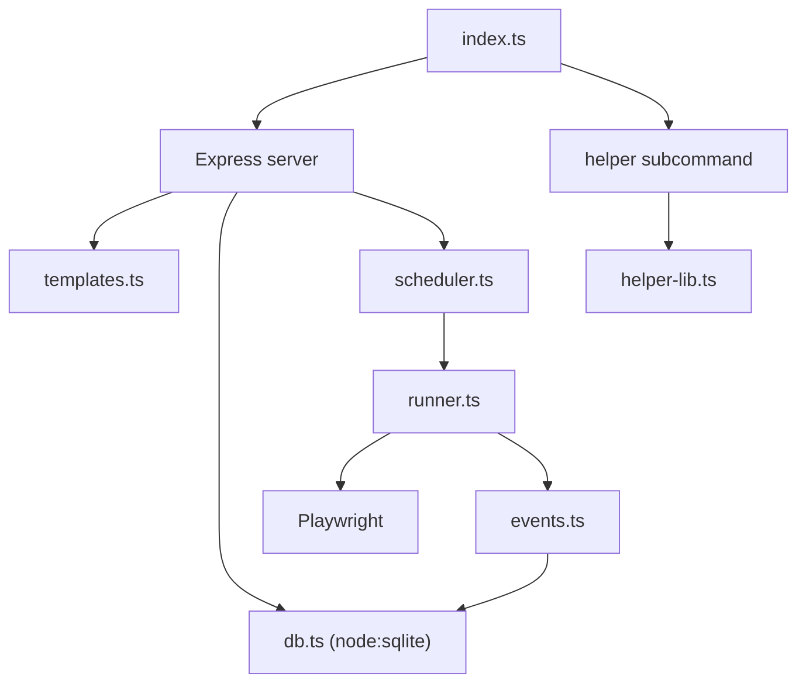

# garden

To install dependencies:

```bash
npm install
```

Requires Node 24 (use `fnm` with `.node-version`) and Google Chrome for site runs. The Docker image installs Chrome automatically. For local runs, install Google Chrome first.

To run:

```bash
node --experimental-strip-types index.ts
```

Helper CLI (subcommand):

```bash
node --experimental-strip-types index.ts helper record [url] --upload-to http://localhost:3000 --site-id <id>
```

## Browser fingerprint lab

Run `npm run mock:site` and open [the browser fingerprint lab](http://localhost:4001/browser-fingerprint). It compares the HTTP `User-Agent` and `Sec-CH-UA` headers with `navigator.userAgent` and `navigator.userAgentData.brands`. It also shows `navigator.webdriver` separately as an automation signal.

With Google Chrome installed, run the live check in a second terminal:

```bash
npx playwright install chromium --only-shell
node --experimental-strip-types testing/browser-fingerprint-check.ts
```

The check compares installed Chrome, Playwright's default headless Chromium shell, and three Chromium overrides. A Playwright `userAgent` override leaves the Chromium brand hints visible. A DevTools user-agent override without metadata suppresses the hints, so the page reports a Chrome-like user agent. Overriding both the string and the brand hints through DevTools makes Chromium report the same brand as Chrome.

Garden's runner uses branded Chrome with its installed version, brand hints, and native platform. On Linux, the user agent and platform client hints report Linux.

Codebase map:


